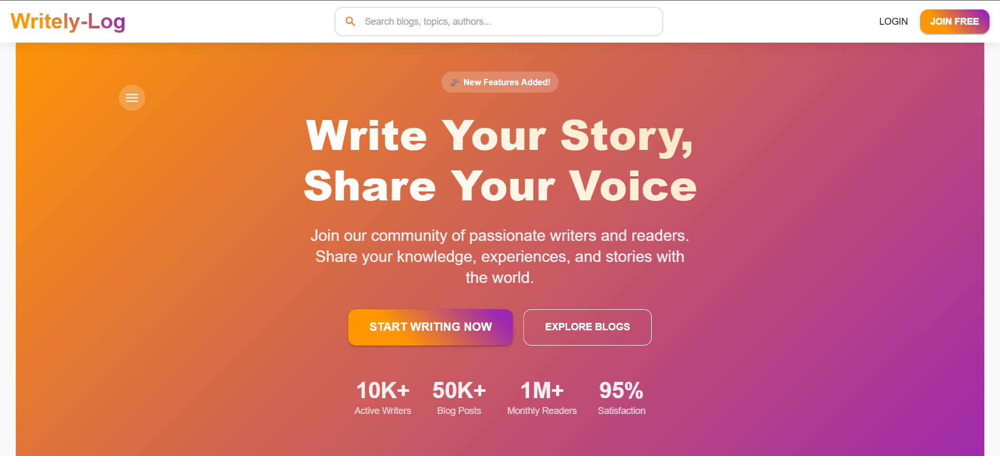
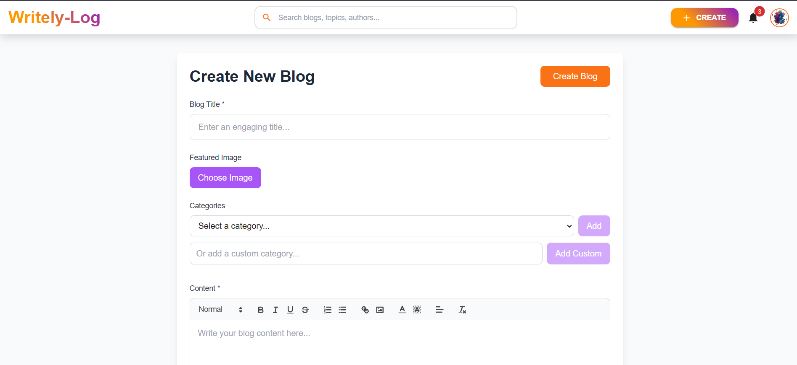
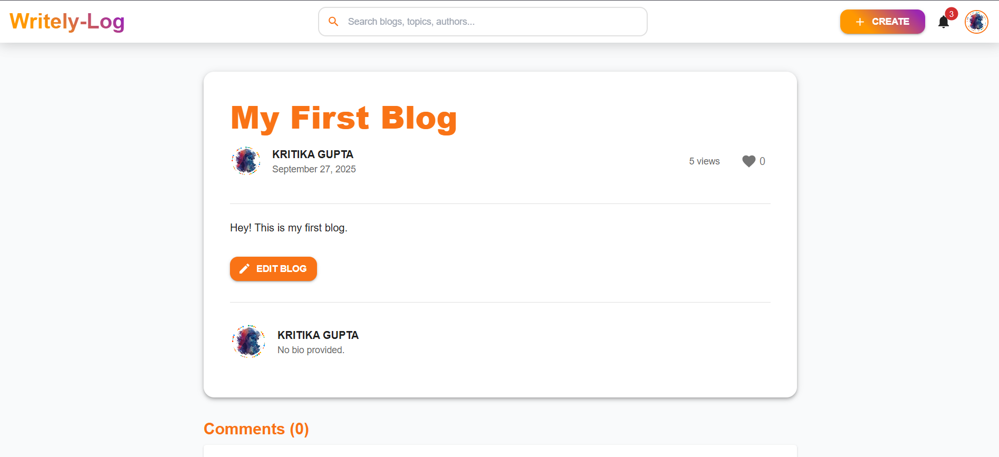
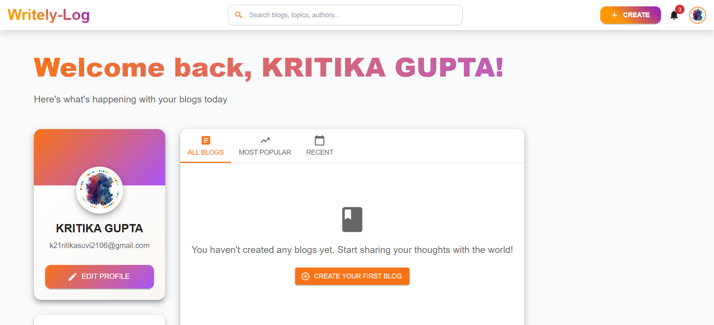

e or# Blog-with-me: MERN Stack Blogging Platform

A full-stack blogging application built with the MERN stack (MongoDB, Express.js, React, Node.js). This platform allows users to create, edit, delete, and interact with blog posts using a rich text editor (Quill.js). Features include user authentication, blog management with categories and featured images, likes, comments, and a user dashboard. The backend handles CRUD operations securely with JWT authentication, and the frontend uses Redux for state management.

## 🚀 Features

### 👥 User Experience
- 🔐 **Secure Authentication** - JWT-based login/register with role-based access
- ✍️ **Rich Text Editor** - Quill.js integration with image uploads via Cloudinary
- 📱 **Responsive Design** - Mobile-first approach with Material-UI components
- ❤️ **Interactive Features** - Like/unlike blogs and comment system
- 🔍 **Smart Discovery** - Category filtering and search functionality

### ⚡ Technical Excellence
- 🔄 **Real-time Updates** - Redux-powered state management for seamless UX
- 🛡️ **Security First** - Protected routes and backend authentication middleware
- 📸 **Media Management** - Cloudinary integration for optimized image handling
- 🎨 **Modern UI/UX** - Smooth animations and intuitive user interface

### 🛠️ Admin Capabilities
- 👑 **Role Management** - Admin and user roles with appropriate permissions
- 📊 **Content Moderation** - Secure blog management and user oversight
- ⚙️ **Dashboard Control** - Comprehensive admin interface for content management

## 📱 Preview

### Screenshots
- **Home/Dashboard**: List of blogs with search and categories.
   <!-- Replace with actual screenshot URL if available -->

- **Create/Edit Blog**: Form with title, rich text editor, categories, and image upload.
   <!-- Replace with actual screenshot -->

- **Blog Detail**: Full post view with likes, comments, and edit button for authors.
   <!-- Replace with actual screenshot -->

- **User Dashboard**: Manage personal blogs with edit/delete actions.
   <!-- Replace with actual screenshot -->

### Live Demo
- **Website Link**: [Writely-Log](https://writely-log.netlify.app/) <!-- Replace with actual deployed URL, e.g., Netlify or Vercel -->
- **GitHub Repository**: [github.com/ksuvii21/Blog-with-me](https://github.com/ksuvii21/Blog-with-me) <!-- Adjust username/repo as needed -->

## 🛠️ Technology Stack

### Backend Technologies
| Technology | Purpose | Version |
|------------|---------|---------|
| Node.js | Runtime Environment | 16+ |
| Express.js | Web Framework | 4.18+ |
| MongoDB | Database | 5.0+ |
| Mongoose | ODM Library | 6.0+ |
| JWT | Authentication | 8.5+ |
| bcryptjs | Password Hashing | 2.4+ |
| Cloudinary | Image Management | 1.30+ |
| Multer | File Uploads | 1.4+ |

### Frontend Technologies
| Technology | Purpose | Version |
|------------|---------|---------|
| React.js | UI Library | 18.2+ |
| Redux Toolkit | State Management | 1.8+ |
| Material-UI | Component Library | 5.10+ |
| React Router | Navigation | 6.3+ |
| React Quill | Rich Text Editor | 2.0+ |
| Axios | HTTP Client | 0.27+ |

### Development Tools
- **Nodemon**: Auto-restart for backend dev server.
- **ESLint & Prettier**: Code linting and formatting (configured in frontend).

## 📋 Prerequisites

- Node.js (v16+)
- npm (v8+)
- MongoDB (local or Atlas)
- Cloudinary account (for image uploads)
- Git

## 🚀 Installation & Setup

### 1. Clone the Repository
```bash
git clone https://github.com/hp/Blog-with-me.git
cd Blog-with-me
```

### 2. Backend Setup
```bash
cd backend
npm install
cp .env.example .env  # If .env.example exists, or create .env manually
```

Update `backend/.env`:
```
NODE_ENV=development
PORT=5000
MONGODB_URI=mongodb://localhost:27017/blog-with-me  # Or your MongoDB Atlas URI
JWT_SECRET=your-super-secret-jwt-key-here
CLOUDINARY_CLOUD_NAME=your-cloud-name
CLOUDINARY_API_KEY=your-api-key
CLOUDINARY_API_SECRET=your-api-secret
```

Seed admin user (optional):
```bash
npm run seed:admin
```

Start backend:
```bash
npm run dev  # Development with nodemon
# or
npm start    # Production
```

### 3. Frontend Setup
```bash
cd ../frontend
npm install
```

Update `frontend/.env` if needed (proxy is set to backend port 5000 in package.json).

Start frontend:
```bash
npm start  # Runs on http://localhost:3000
```

### 4. Run the Application
- Backend: http://localhost:5000
- Frontend: http://localhost:3000
- The frontend proxies API calls to the backend automatically.

## 📁 Project Structure

```
Blog-with-me/
├── backend/
│   ├── config/          # Database and env configs
│   ├── controllers/     # API logic (e.g., blogController.js)
│   ├── middleware/      # Auth, validation middleware
│   ├── models/          # Mongoose schemas (Blog, User)
│   ├── routes/          # API routes (auth, blogs)
│   ├── server.js        # Express app entry
│   ├── package.json     # Backend dependencies
│   └── .env             # Environment variables
├── frontend/
│   ├── public/          # Static files (index.html)
│   ├── src/
│   │   ├── components/  # Reusable UI (BlogEditor, Header, LoadingSpinner)
│   │   ├── pages/       # Routes (CreateBlogPage, EditBlogPage, BlogDetailPage, UserDashboardPage)
│   │   ├── redux/       # Slices (blogSlice.js, authSlice)
│   │   ├── utils/       # Helpers (api.js, cloudinary.js)
│   │   └── App.js       # Main app with routing
│   ├── package.json     # Frontend dependencies
│   └── .env             # Frontend env (optional)
├── README.md            # This file
├── TODO.md              # Pending tasks
└── package.json         # Root (if monorepo scripts)
```

## 📡 API Documentation

All endpoints prefixed with `/api`.

### Authentication Endpoints
| Method | Endpoint | Description | Auth Required |
|--------|----------|-------------|---------------|
| POST | `/auth/register` | Create new user account | ❌ |
| POST | `/auth/login` | User login | ❌ |
| GET | `/auth/profile` | Get user profile | ✅ |

### Blog Endpoints
| Method | Endpoint | Description | Auth Required |
|--------|----------|-------------|---------------|
| GET | `/blogs` | Get all blogs (paginated) | ❌ |
| POST | `/blogs` | Create new blog | ✅ |
| GET | `/blogs/:id` | Get single blog | ❌ |
| PUT | `/blogs/:id` | Update blog | ✅ (Author/Admin) |
| DELETE | `/blogs/:id` | Delete blog | ✅ (Author/Admin) |
| POST | `/blogs/:id/like` | Like/unlike blog | ✅ |
| POST | `/blogs/:id/comment` | Add comment | ✅ |

### Image Endpoints
| Method | Endpoint | Description | Auth Required |
|--------|----------|-------------|---------------|
| POST | `/blogs/upload` | Upload image | ✅ |

## 🧪 Testing

### Backend
- Basic tests not implemented yet. Run:
  ```bash
  cd backend
  # Add Jest config and tests in /tests/
  ```

### Frontend
- Run tests:
  ```bash
  cd frontend
  npm test
  ```
- Uses Jest + React Testing Library for components.

## 🚀 Deployment

### Backend (Render/Heroku)
1. Push to GitHub.
2. On Render: New Web Service → Connect repo → Set build command `npm install` → Start command `npm start`.
3. Add env vars in dashboard.

### Frontend (Netlify/Vercel)
1. Push to GitHub.
2. On Netlify: New site from Git → Build command `npm run build` → Publish dir `build`.
3. Update API base URL in frontend utils/api.js for production.

### Database
- Use MongoDB Atlas for cloud DB.
- Update MONGODB_URI in env.

## 🔧 Usage

1. Register/Login as user.
2. Create a blog: Navigate to /create-blog → Use editor for content → Add categories/image → Publish.
3. View blogs: /blogs or /:id for details.
4. Edit/Delete: From /dashboard (user's blogs).
5. Like: Click heart on blog detail → Updates count and state.

## 🤝 Contributing

1. Fork the repo.
2. Create feature branch: `git checkout -b feature/new-feature`.
3. Commit changes: `git commit -m 'Add new feature'`.
4. Push: `git push origin feature/new-feature`.
5. Open PR.

Follow ESLint/Prettier rules. Add tests for new features.

## 📄 License

MIT License - see [LICENSE](LICENSE) file.

## 📞 Contact & Social Media

- **LinkedIn**: [Kritika Gupta](https://www.linkedin.com/in/kritika-gupta2106)
- **GitHub**: [ksuvii21](https://github.com/ksuvii21)
- **Portfolio**: [Personal Portfolio](https://ksuvii21.github.io/ksuvii.github.io/)
- Issues: [Create Issue](https://github.com/hp/Blog-with-me/issues)

## 📈 Future Enhancements (from TODO.md)
- Add tags and summary fields to create/edit forms.
- Implement comments fully.
- Add admin dashboard for moderation.
- Email notifications.
- Advanced search.

---

Built with ❤️ for blogging enthusiasts. Contributions welcome!
